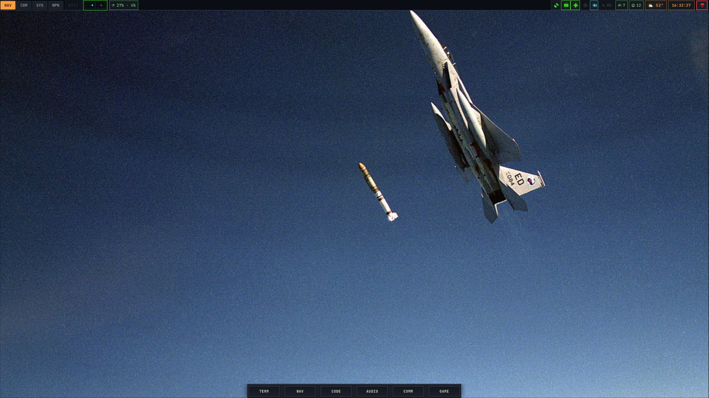
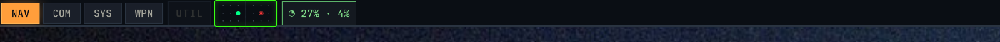
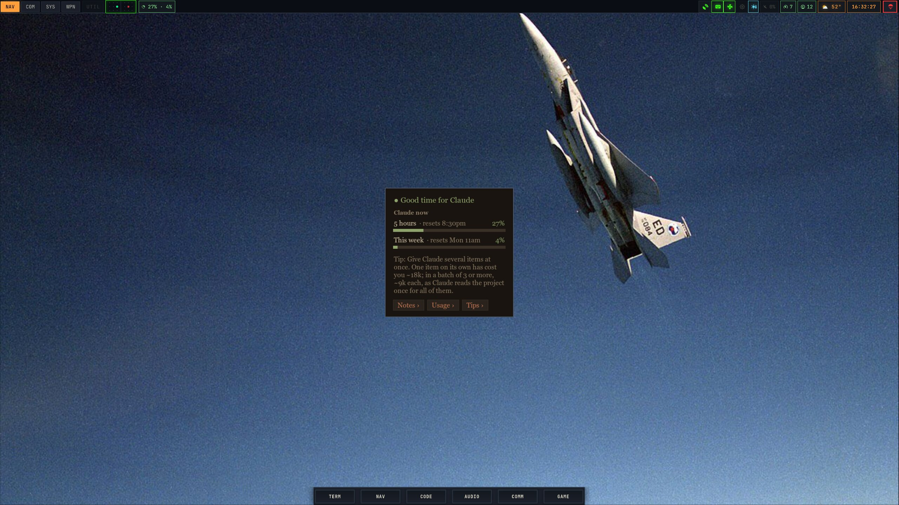

# Lando mode

insideabush's ask (2026-11-09): VibeNote for Lando, who talks to Claude himself: no Work
(nothing is ever sent to Claude), "minimized almost like a miniplayer ... or something like a
taskbar extension ... not a lot of text by default, he should be able to open up info if
needed ... a token checking and optimization service". His pick: **bars + one tip**.

## What it is (in this repo)

- **Lando mode turns on by itself** for anyone but `insideabush` (and root). `vibenote --lando`
  (or `VIBENOTE_MODE=lando`) shows it on insideabush's computer too.
- **Mini player** (`Mini` in `main.py`): the good-time dot, the 5-hour and weekly bars, one
  tip, and Notes › / Usage › / Tips ›, which open the whole app without Work (no Work
  button, column or tick-all).
- **Top-bar piece**: `vibenote --bar` prints Waybar JSON, e.g.
  `{"text": "◔ 27% · 4%", "tooltip": "5 hours: 27% · resets 8:30pm\n...", "class": "low"}`
  (class `low` / `mid` ≥50% / `high` ≥80%, by the fuller limit).
- Lando's own Claude files are used (`~/.claude`, `~/.claude.json`, data in
  `~/.local/share/vibenote`), and VibeNote refreshes them itself (live numbers at most once a
  minute, learned usage every 5 minutes): no root, no Glade hook.
- His projects: `~/projects/*` with a `.vibe-project`, else any git folder in `~/projects` (or
  his home).

## The config change it needs (for a `vibe` → "Change or fix something on your computer" session)

1. Install VibeNote on Lando's machines (gaming-pc first): `customConfig.programs.vibenote`.
2. A Waybar module on the century-series top bar, right after `custom/claude-rwr`
   (`modules/home-manager/hyprland/desktops/century-series/waybar.nix`, and the module list
   in `de-wm-components/waybar/functional.nix`):

   ```nix
   "custom/vibenote" = {
     exec = "vibenote --bar";
     return-type = "json";
     interval = 60;
     tooltip = true;
     on-click = "vibenote --toggle";   # opens the mini player; a second click closes it
   };
   ```

   CSS, matching the PWR / MEM dials:

   ```css
   #custom-vibenote {
     padding: 0 8px; margin: 2px;
     background-color: @c_bg_tertiary;
     border: 1px solid @c_accent_green_dim;
     color: @c_accent_green;
     font-family: "JetBrainsMono Nerd Font", "JetBrains Mono", monospace;
   }
   #custom-vibenote.mid { color: @c_accent_amber; border-color: @c_accent_amber_dim; }
   #custom-vibenote.high { color: @c_warning_red; border-color: @c_warning_red; }
   ```

3. The PR includes these pictures (his ask):

   
   
   

## How the pictures were made

`desktop.jpg` and `top-bar.png` are Lando's **real** gaming-pc top bar: the Waybar config and
style built from `nixosConfigurations.gaming-pc` (home-manager, user lando), the daytime
century-series palette (`colors.nix`, `paletteSteps`, step 0), JetBrainsMono Nerd Font, the
f-15-satellite wallpaper at 2560×1440 scale 1.0667, with the module and CSS above added and
sample numbers. It ran in an off-screen sway (`WLR_BACKENDS=headless`, under
`dbus-run-session`) as insideabush, captured with `grim`. Nested Hyprland would not start
off-screen, so `hyprland/workspaces`/`window`/`mode` ran as their sway twins (same settings,
same CSS) — the only stand-ins. In `desktop-mini-player.jpg` the mini player (a VibeNote
screenshot with the same sample numbers) is laid onto that picture where Hyprland centres a
new floating window; its window border is approximate.
